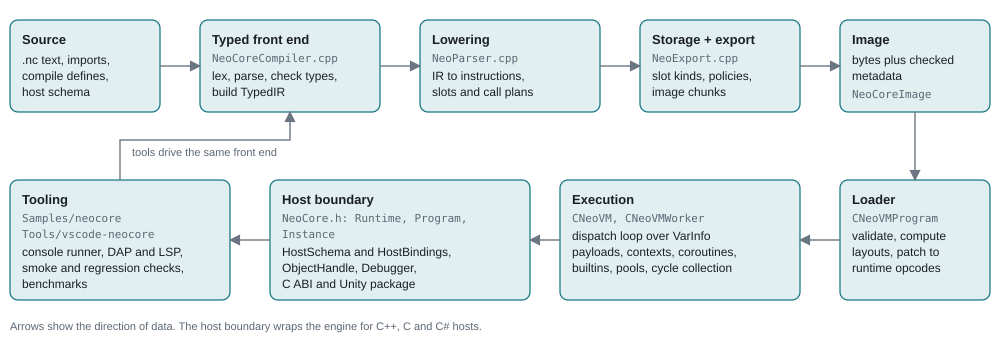
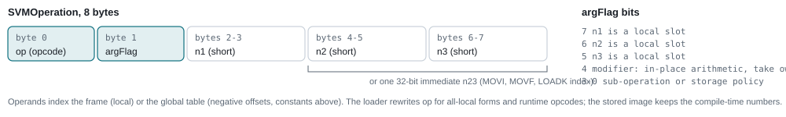
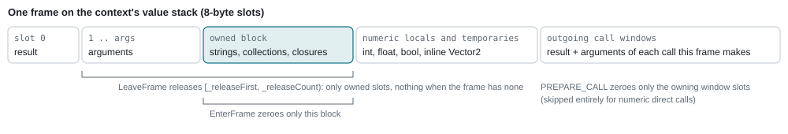
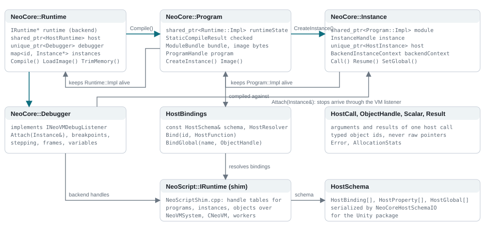
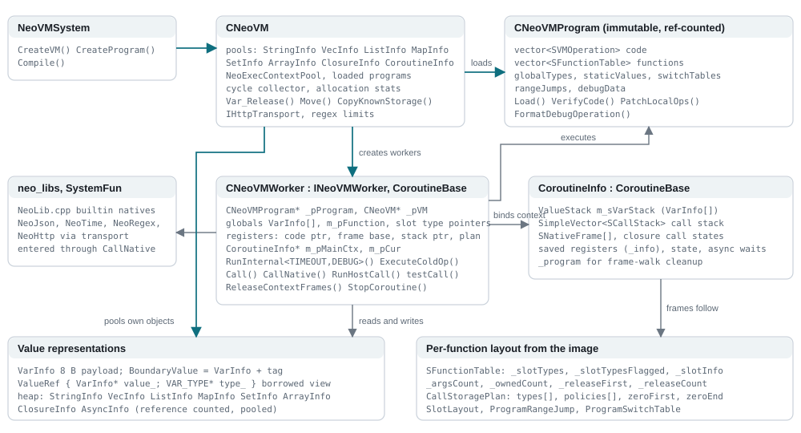
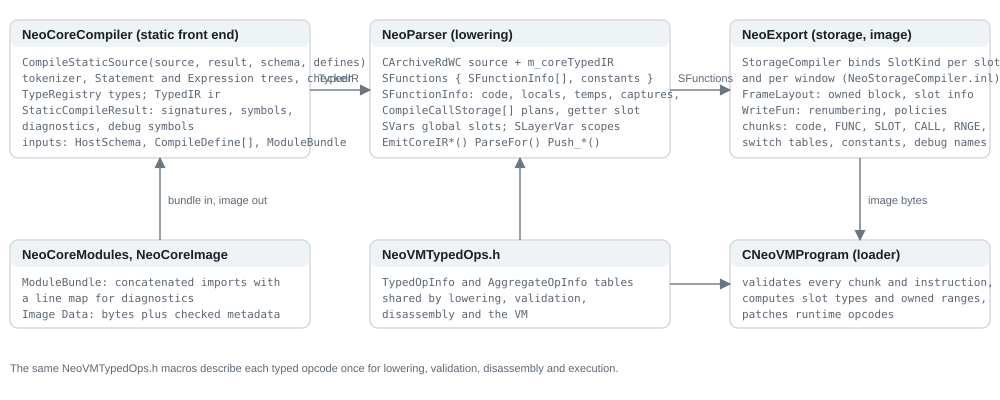

# NeoCore Architecture

How a `.nc` source becomes a checked image and runs inside the untagged eight-byte
VM, which classes own what, and where the host, tooling and tests attach. Written
against the `dev` branch on 2026-11-08 (image version `0164`). The same content with
page styling is [Architecture.html](Architecture.html) for local viewing; the figures
below are shared by both pages. The design documents this page summarizes are
[StaticTyping.md](StaticTyping.md), [TypedStorage.md](TypedStorage.md),
[HostBindings.md](HostBindings.md), [Embedding.md](Embedding.md) and
[RuntimeContracts.md](RuntimeContracts.md).

| Fact | Value |
| --- | --- |
| VM slot (`VarInfo`) | 8 bytes, untagged |
| Instruction (`SVMOperation`) | 8 bytes, one-byte opcode |
| Boundary view (`ValueRef`) | two pointers |
| Image version (`NEO_VER`) | `0164` |

Contents: [Pipeline](#1-pipeline) · [Typed front end](#2-typed-front-end) ·
[Lowering and export](#3-lowering-storage-inference-and-export) ·
[Image and loader](#4-image-format-and-loader) · [Virtual machine](#5-virtual-machine) ·
[Values and storage](#6-values-and-storage) · [API and host boundary](#7-public-api-and-host-boundary) ·
[Tooling and tests](#8-tooling-samples-and-tests) · [Class diagrams](#9-class-relationship-diagrams) ·
[Source map](#10-source-map)

## 1. Pipeline

Five stages hand plain data structures to each other. No stage keeps pointers into
another stage's state after the hand-off, which is what lets the console compile
without running, the loader validate images produced earlier, and hosts load an
image without the front end.

*Figure 1. Source to execution. The image in the middle is the only persistent
artifact; everything to its right is rebuilt from it at load time.*

Three decisions shape the rest of this page.

- **Checked before lowered.** The typed front end rejects a program before any
  instruction exists, so lowering never infers a type; it reads the typed IR and the
  signatures the front end recorded.
- **The compiler owns storage.** Frame layouts, call windows and copy and release
  policies are decided at compile time and serialized. The loader validates them.
  The VM never writes a type tag into a frame slot.
- **Untagged payloads.** A VM slot is eight bytes. Types live in the instruction, in
  an immutable per-function table, or in the tagged boundary values that collections
  and hosts use.

## 2. Typed front end

`NeoCoreCompiler.cpp` holds the complete static language: a tokenizer, a
recursive-descent parser that builds statement and expression trees, and a checker
that resolves names, types and conversions. Its output is `StaticCompileResult`: the
`TypedIR`, function and global signatures, debug symbols and the diagnostics list.
Compile-time definitions and the optional host schema are inputs. Imports are
resolved beforehand by `NeoCoreModules.cpp`, which concatenates module sources into
a `ModuleBundle` and keeps a line map so diagnostics point at the original file.

| Class | Role |
| --- | --- |
| `TypeRegistry`, `TypeDesc` | Interned type identities: scalars, strings, vectors and quaternions, lists, maps, sets, typed arrays, structs with `StructField` lists, function types, host object types and builtin objects. A `TypeId` is an index; the kind decides storage later. |
| `TypedIR`, `IRFunction`, `IRNode` | The checked expression graph. Each function records parameter and return types; each node records its value type and operands, so lowering emits fixed numeric instructions, selectors and typed element access without inference. |
| `HostSchema`, `HostBinding`, `HostProperty`, `HostGlobal` | Host functions, properties and globals with exact signatures and binding ids. The checker treats them as part of the language; the loader and runtime validate calls against the same ids. Schemas serialize for the Unity package. |
| `NeoCoreBuiltins.h` | The builtin surface the checker knows: string, list, map, set, array, math, time, JSON, HTTP, coroutine and system entries with their types. |
| `NeoCoreDiagnostics.h`, `NeoCompileLimits.h` | Diagnostic records with source spans, and the fixed compile limits (argument counts, slot counts, literal sizes) that both the front end and lowering enforce. |

## 3. Lowering, storage inference and export

Lowering reuses the NeoScript parser machinery (`NeoParser.cpp`, `NeoTextLoader.h`)
as an instruction emitter. The source is re-read through `CArchiveRdWC`, but typed
constructs are emitted from the `TypedIR` attached to the archive: numeric
expressions, scalar writes, calls and returns come from the IR with exact
signatures, ordered arguments and explicit value copies. Per-function state lives in
`SFunctionInfo` (code buffer, locals, temporaries, captures, call plans) under
`SFunctions`; globals live in `SVars`.

- **Call plans.** Each call site records a `CompileCallStorage` plan with its
  argument sources, result slot and the code position at which the plan becomes
  active. A direct call whose window holds only payload values emits no
  `PREPARE_CALL`, and the last computed argument writes straight into the window slot.
- **Getter folding.** A function whose whole body returns one global is remembered
  when it is finalized; later argument-less calls to it become a copy of that global.
- **Storage inference.** `NeoStorageCompiler.inl` walks the emitted instructions and
  the call plans until no slot kind changes, binding every local, temporary, global
  and window slot to a `SlotKind`. A conflict is a compile error that names the slot
  and both kinds.
- **Export.** `NeoExport.cpp` permutes each frame so owned slots form one block after
  the arguments, stamps the copy or release policy on every `MOV`, `LOADK` and
  `VAR_CLEAR`, renumbers operands to frame slots and writes the image chunks.

*Figure 2. The instruction word. The one-byte opcode is why the dispatch loop can
select a handler with a single jump table, and the low nibble is where a copy
carries its storage policy.*

## 4. Image format and loader

An image is a byte buffer stamped with `NEO_VER` from `NeoConfig.h`. Every change to
opcodes, layouts or validation bumps the version, and the loader refuses older
images with a message instead of guessing. `NeoCoreImage` pairs the bytes with the
checked metadata a host needs to bind the program without recompiling.
`CNeoVMProgram::Create` runs three passes:

1. **Load** reads the chunks into `SFunctionTable` records, `CallStoragePlan`s,
   switch tables, range descriptors, constants and the global type table.
2. **VerifyCode** checks every instruction: operand ranges against the frame, policy
   bytes against declared kinds, jump targets, plan indices and call signatures.
3. **PatchLocalOps** rewrites the code for execution: all-local operand forms,
   static-string map reads, one-byte runtime opcodes for the numeric families,
   integer immediate forms, local copy and immediate-store forms, typed range
   branches, in-place loop-entry tests and paired adjacent instructions (the
   second instruction stays in place for incoming branches). These opcodes never
   appear in a stored image; the disassembler maps them back.

A loaded program is immutable and reference counted. Several VMs, instances and
threads share one program.

## 5. Virtual machine

`CNeoVM` is the engine instance. It owns the allocation pools for strings, vectors,
lists, maps, sets, typed arrays, closures, coroutines and async requests, the
execution-context pool, the loaded programs and the cycle collector. `CNeoVMWorker`
is one execution engine over a VM: it holds the current program, the globals of an
instance, the active context and the registers of the running frame. Each
activation runs inside a `CoroutineInfo` context from `NeoExecContextPool`; the main
context and user coroutines share one representation, so `sleep`, `yield`, time
slices and breakpoints only park a context.

### Dispatch loop

`RunInternal<TIMEOUT, DEBUG>` switches on the opcode byte of the current instruction
and keeps only the frequent instructions inline: copies and clears, branches and
loops, calls and returns, the runtime numeric opcodes, typed element access and map
lookups. Every other opcode goes through `ExecuteColdOp`, a separate function with
its own switch. Keeping the loop small is what lets the compiler hold the worker
pointer in a register and lay out each handler as one block that ends in the
dispatch jump. Handlers live in `NeoVMWorker_Handlers.inl` (generic),
`NeoVMWorker_Typed.inl` (numeric, vector, array and container) and
`NeoVMWorker_Move.inl` (copies and script calls).

### Frames and calls

*Figure 3. Frame layout decided by the exporter. The callee's frame starts at the
caller's window, so arguments are never copied twice.*

Script calls push an `SCallStack` record with the return address, frame base and the
caller's function index; natives run through `CallNative` with the plan that
describes their window. Errors and cancellation enumerate the saved frames
(`ForEachContextFrameSlot`) through the program's layouts to release owned values
exactly once and then zero the used stack range. There is no per-frame runtime
table and no high-water sweep.

### Builtins, libraries and memory

`NeoLib.cpp` implements the builtin natives behind the `neo_libs` tables.
`NeoJson.cpp`, `NeoTime.cpp`, `NeoRegex.cpp` (vendored PCRE2) and `NeoHttp.h`
(through a host-supplied `IHttpTransport`) back the library modules. Heap objects
are reference counted; containers that can form cycles are tracked, `CollectCycles`
frees unreachable groups, and `TrimMemory` returns empty pool pages to the system.

## 6. Values and storage

| Representation | Where it lives | Type information |
| --- | --- | --- |
| `VarInfo` (8 bytes) | Frame slots, globals, constants, closure captures, typed vector arrays | The instruction, the function's slot table or the call plan. Never a tag in the slot. |
| `BoundaryValue` (`VarInfo` plus a one-byte tag) | List, map and set entries; host transfers; native scratch values; GC work lists | Its own tag. |
| `ValueRef` (payload pointer plus type-byte pointer) | A borrowed view created only at boundaries: collections, natives, conversions, the debugger | The pointed-to byte. For a fixed slot it is a read-only copy of the declared type marked with `NEOS_TYPE_READONLY`, so a view can never write a tag into a frame. |
| Heap objects | `StringInfo`, `VecInfo`, `ListInfo`, `MapInfo`, `SetInfo`, `ArrayInfo`, `ClosureInfo`, `CoroutineInfo`, `AsyncInfo`, pooled by `CNeoVM` | Reference counted; copy and release follow the storage policy carried in the instruction or layout. |

Nullability follows the type: numbers, vectors, quaternions and structs never hold
null; strings, collections, function values, coroutines and host objects use a zero
payload for null. Structs are value types stored as lists and copied on assignment.
Vectors with three or four components share `VecInfo` storage with copy-on-write;
two-component vectors are inline.

## 7. Public API and host boundary

`NeoSource/NeoCore.h` (namespace `NeoCore`) is the embedding API. A `Runtime` owns
the backend engine, a `HostRuntime` that resolves host bindings, and an optional
`Debugger`. `Runtime::Compile` runs the front end and lowering and returns a
`Program`, which keeps the checked result, the module bundle, the image bytes and
the backend program handle. `Program::CreateInstance` produces an `Instance` with
its own globals, a `HostInstance` for per-instance host objects and the handle used
to call script functions with `Scalar` arguments and `Result` values. Hosts never see
`VarInfo`; values cross the boundary as `BoundaryValue` conversions in
`NeoCoreValueBoundary` and `NeoCoreHostBridge`.

- **Bindings.** `HostBindings` pairs a `HostSchema` with a resolver and functions
  keyed by binding id. Receivers are typed ids validated on every access; borrowed
  pointers cannot survive reentry or external deletion. The rules are in
  [HostBindings.md](HostBindings.md).
- **Backend shim.** `NeoScriptShim.cpp` implements the backend-facing `IRuntime` over
  `NeoVMSystem`, `CNeoVM` and the workers, keeping handle tables for programs,
  instances and registered objects so the public API never exposes engine pointers.
- **Debugger.** `Debugger` attaches to an instance, implements `INeoVMDebugListener`
  and exposes breakpoints, stepping, stack frames and variables. The DAP server in
  the console sits on top of it.
- **C ABI and Unity.** `Unity/NeoCore/NeoCoreC.h` is the C header over the same API;
  `Unity/com.neocore.unity` is the C# package with managed value wrappers, schema
  import and callbacks.

## 8. Tooling, samples and tests

| Component | Location | Notes |
| --- | --- | --- |
| Console runner | `Samples/neocore` | `neocore --file`, `--check`, `--asm`, `--debug`; sample and regression modes (`--smoke`, `--bench-check`, `--compiler-error-regression`, `--pooltrim-check`); the stdio `--dap` and `--lsp` servers. `ConsoleHost.cpp` provides the host schema the samples use. |
| Benchmarks | `Samples/bench` | `bench.nc` (timed) and `check.nc` (checksums only) with the Lua and C++ references. Results and method: [FourWayBenchmark.md](FourWayBenchmark.md). |
| Mini game | `Samples/neocore/minigame` | A small C++ host that binds a schema and runs a script per frame. |
| VS Code extension | `Tools/vscode-neocore` | Highlighting, completion and diagnostics through the LSP mode; debugging through the DAP mode. |
| Tests | `Tests` | C++ regressions under CTest (storage, typed ops, collections, hosts, images, modules, debugger) and Python protocol and CLI regressions. Linux builds and the Android NDK syntax check guard the non-Windows paths. |

## 9. Class relationship diagrams

Teal arrows mean ownership (the source creates and destroys the target); grey arrows
mean a non-owning reference or a call relationship.

### Public API

*Figure 4. Lifetimes compose through shared pointers: a Program keeps its Runtime
state alive and an Instance keeps its Program alive, so a host never has to order
destruction.*

### Virtual machine core

*Figure 5. A worker runs one context at a time. Every frame it executes is described
by the program's immutable layout, which is why cleanup after an error can walk
saved frames without any per-frame runtime table.*

### Compiler

*Figure 6. Compiler stages exchange plain data; no stage keeps pointers into another
stage's state after the hand-off. The same `NeoVMTypedOps.h` macros describe each
typed opcode once for lowering, validation, disassembly and execution.*

## 10. Source map

| Area | Files | Responsibility |
| --- | --- | --- |
| Public API | `NeoCore.h/.cpp`, `NeoCoreHost*.h/.cpp`, `NeoCoreInstanceContext.h`, `NeoCoreValueBoundary.h/.inl`, `NeoCoreValues.inl`, `NeoCoreDebugger.h/.inl`, `NeoCoreDebugAccess.h`, `NeoCoreConsoleAccess.h`, `NeoCoreOptions.h` | Runtime, Program, Instance, host bindings and schema, value conversion at the boundary, debugger, console and debug access points. |
| Front end | `NeoCoreCompiler.h/.cpp`, `NeoCoreTypes.h/.cpp`, `NeoCoreIR.h`, `NeoCoreBuiltins.h`, `NeoCoreDiagnostics.h`, `NeoCompileLimits.h`, `NeoCoreModules.h/.cpp`, `NeoCoreImage.h/.cpp`, `NeoCoreTextFile.h`, `NeoCoreScriptHost.h` | Static language, type registry, typed IR, builtin surface, limits, module bundling, image container. |
| Lowering and export | `NeoParser.h/.cpp`, `NeoTextLoader.h/.cpp`, `NeoExport.h/.cpp`, `NeoStorageCompiler.inl`, `NeoNumberLiteral.h`, `NeoArchive.h` | Instruction emission from the typed IR, storage inference, frame layout, image writing. |
| Program and VM | `NeoVM.h/.cpp`, `NeoVMInternal.h`, `NeoVMProgram.h/.cpp`, `NeoVMWorker.h/.cpp/.inl`, `NeoVMWorker_Handlers.inl`, `NeoVMWorker_Typed.inl`, `NeoVMWorker_Move.inl`, `NeoVMWorker_Var.inl`, `NeoVMTypedOps.h`, `NeoVMError.h`, `NeoConfig.h`, `NeoNumeric.h` | Loader and validation, dispatch loop and handlers, calls and frames, errors, opcode tables, image version. |
| Heap objects | `NeoVMList.h/.cpp`, `NeoVMMap.h/.cpp`, `NeoVMSet.h/.cpp`, `NeoVMArray.h`, `NeoVMVector.h`, `NeoVMHash.h`, `NeoVMMemoryPool.h`, `NeoQueue.h`, `UTFString.h`, `NeoStringLimits.h` | Collections, typed arrays, vector storage, hashing, pools and string utilities. |
| Libraries | `NeoLib.cpp`, `NeoLibDCall.h`, `NeoJson.h/.cpp`, `NeoJsonVendor.cpp`, `NeoTime.h/.cpp`, `NeoHttp.h`, `NeoRegex.h/.cpp` | Builtin natives, JSON, time, HTTP transport interface, regular expressions. |
| Backend shim | `NeoScript.h`, `NeoScriptShim.cpp` | The `IRuntime` interface and its implementation over the engine with handle tables. |
| Hosts and tools | `Samples/neocore`, `Samples/neocore/minigame`, `Samples/bench`, `Unity/NeoCore`, `Unity/com.neocore.unity`, `Tools/vscode-neocore`, `Tests` | Console and servers, sample host, benchmarks, C ABI and Unity package, editor extension, regressions. |

The typed VM migration is ongoing. [StaticTyping.md](StaticTyping.md) lists the
implemented subset and remaining milestones, and [TypedStorage.md](TypedStorage.md)
records the current storage rules; keep this page in step with both when the
pipeline or ownership changes.
